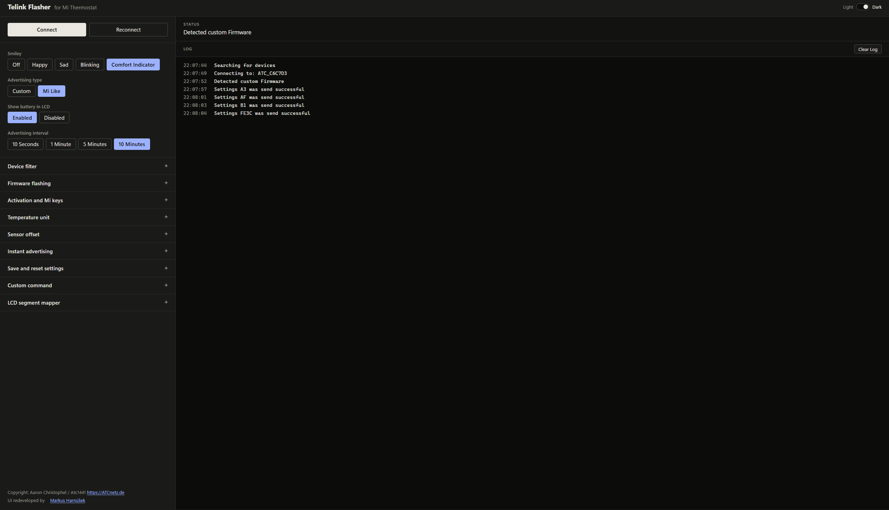

# Telink Flasher

A browser-based flasher and settings tool for Xiaomi Mi thermometers (LYWSD03MMC) and other Telink BLE devices. It talks to the device directly over Web Bluetooth, so there is nothing to install on the device side and no data leaves your computer.

This is a redeveloped user interface for the original [Telink Flasher by Aaron Christophel (atc1441)](https://github.com/atc1441/ATC_MiThermometer). The flashing, activation and settings logic is ported unchanged from the original; only the interface and the project structure are new.

## Features

- **Flash firmware** — upload a Telink `.bin` file over the air.
- **Activate stock devices** — run the Mi activation or log in with an existing token to obtain the Mi Token and Bind Key.
- **Configure the custom firmware** — smiley, advertising type and interval, battery display, temperature unit, sensor offsets, instant advertising, and saving or resetting settings.
- **Applied settings stay highlighted** — the common settings show which option you last sent successfully.
- **Raw commands and LCD segment mapper** — for anything the buttons do not cover.
- **Live log and status** — everything the tool does is shown on the right.
- **Light and dark mode** — follows your system setting and remembers your choice.

## Requirements

- A browser with Web Bluetooth: Chrome, Edge or another Chromium-based browser on desktop or Android. Firefox and Safari are not supported.
- The page must be served over HTTPS or from `localhost`.
- [Node.js](https://nodejs.org) 20 or newer, only if you want to run or build it yourself.

## Usage

1. Click **Connect** and pick your thermometer in the browser dialog. Use **Device filter** to narrow the list by name.
2. The status line shows whether the stock Mi firmware or the custom firmware was detected.
3. To flash a device on stock firmware:
   1. Open **Activation and Mi keys** and click **Do Activation**. Wait for the login to succeed.
   2. Open **Firmware flashing**, choose a `.bin` file and click **Start Flashing**.
4. On a device running the custom firmware, use the settings on the left. Open **Save and reset settings** and save to flash if the settings should survive a battery change.

Activating a device here means it has to be activated again in the Mi Home app if you want to use it there.

Custom firmware builds and a video manual are available in the [ATC_MiThermometer repository](https://github.com/atc1441/ATC_MiThermometer).

## Credits

- Original Telink Flasher and custom firmware: Aaron Christophel / atc1441 — [atcnetz.de](https://atcnetz.de), [ATC_MiThermometer](https://github.com/atc1441/ATC_MiThermometer)
- UI redevelopment: Markus Harnúšek
- Cryptography: [Stanford Javascript Crypto Library](https://github.com/bitwiseshiftleft/sjcl)
